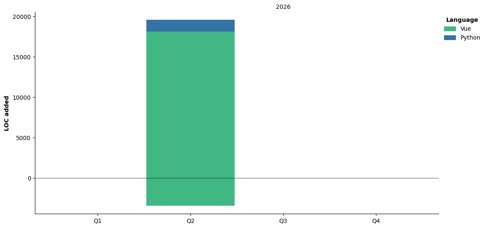

  
  
<a href="https://wakatime.com/@d0575786-8e2a-41e6-9628-4e7af5f22442"></a>
  
 

 <details>
   
 <!--START_SECTION:waka-->


**🐱 My GitHub Data** 

> 📦 ? Used in GitHub's Storage 
 > 
> 🏆 162 Contributions in the Year 2026
 > 
> 🚫 Not Opted to Hire
 > 
> 📜 11 Public Repositories 
 > 
> 🔑 0 Private Repositories 
 > 
**I'm an Early 🐤** 

```text
🌞 Morning                86 commits          ██████░░░░░░░░░░░░░░░░░░░   25.90 % 
🌆 Daytime                161 commits         ████████████░░░░░░░░░░░░░   48.49 % 
🌃 Evening                64 commits          █████░░░░░░░░░░░░░░░░░░░░   19.28 % 
🌙 Night                  21 commits          ██░░░░░░░░░░░░░░░░░░░░░░░   06.33 % 
```
📅 **I'm Most Productive on Thursday** 

```text
Monday                   29 commits          ██░░░░░░░░░░░░░░░░░░░░░░░   08.73 % 
Tuesday                  43 commits          ███░░░░░░░░░░░░░░░░░░░░░░   12.95 % 
Wednesday                44 commits          ███░░░░░░░░░░░░░░░░░░░░░░   13.25 % 
Thursday                 80 commits          ██████░░░░░░░░░░░░░░░░░░░   24.10 % 
Friday                   44 commits          ███░░░░░░░░░░░░░░░░░░░░░░   13.25 % 
Saturday                 57 commits          ████░░░░░░░░░░░░░░░░░░░░░   17.17 % 
Sunday                   35 commits          ███░░░░░░░░░░░░░░░░░░░░░░   10.54 % 
```


📊 **This Week I Spent My Time On** 

```text
💬 Programming Languages: 
Python                   6 hrs 24 mins       ██████████░░░░░░░░░░░░░░░   41.54 % 
TypeScript               2 hrs 50 mins       █████░░░░░░░░░░░░░░░░░░░░   18.46 % 
Markdown                 1 hr 39 mins        ███░░░░░░░░░░░░░░░░░░░░░░   10.69 % 
Other                    48 mins             █░░░░░░░░░░░░░░░░░░░░░░░░   05.19 % 
Image (png)              40 mins             █░░░░░░░░░░░░░░░░░░░░░░░░   04.34 % 
```

🤖 **AI Coding This Week** 

```text
⏱ AI Coding Time: 11 hrs 40 mins (75.59%)

✍️ 72,825 lines written by AI, 705 lines written by hand (99.04% AI-written)

🔤 2,779,520 Input Tokens, 902,320 Output Tokens

💵 $526.37 Estimated AI Cost This Week

🧠 11 AI Sessions, 49 AI Prompts

GLM                      54,362 lines        ██████████████████░░░░░░░   73.67 % 
DeepSeek                 19,428 lines        ███████░░░░░░░░░░░░░░░░░░   26.33 % 

🔎 AI Coding Insights:
🤖 AI-Driven — 99.04% of written lines came from AI
📝 Concise Prompter — average 496 characters per prompt
🔁 Iterative Prompter — average 4 prompts per session
🚀 High AI Trust — 1.58% of changed lines were hand-edited
```

**I Mostly Code in Python** 

```text
Python                   4 repos             ████████████░░░░░░░░░░░░░   50.00 % 
Vue                      3 repos             █████████░░░░░░░░░░░░░░░░   37.50 % 
HTML                     1 repo              ███░░░░░░░░░░░░░░░░░░░░░░   12.50 % 
```


**Timeline**




 Last Updated on 01/11/2026 05:45:14 UTC
<!--END_SECTION:waka-->

</details>


## 👽Who I am

NJUPTer level 2025,代码爱好者


## 🥰Contact me
<ul>
  <li>email:dougunduzi@outlook.com</li>
  <li>QQ:2691296657</li>
  <li>QQ(bot):3547943155</li>
</ul>
